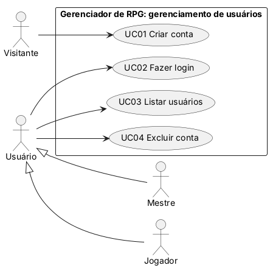
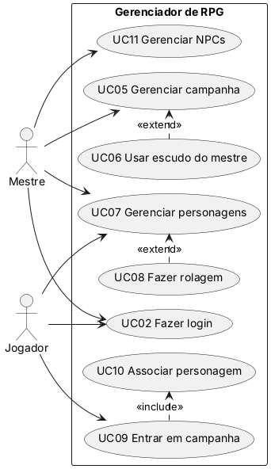

# Casos de uso

> Seção 6 do modelo. Os **requisitos** (RF) e seus **cenários de aceitação** estão em `openspec/specs/`.
> Aqui ficam o diagrama do **gerenciamento de usuários** (Sprint 1, núcleo da Entrega 1), o diagrama geral do sistema e a descrição detalhada dos casos de uso mais importantes.

## 6.1 Diagrama de casos de uso: gerenciamento de usuários (S1.1)

Dois tipos de usuário, **Mestre** e **Jogador**, especializam o ator **Usuário** (generalização de atores). O **Visitante** ainda não tem conta. Fonte do diagrama em PlantUML: [`casos-de-uso.puml`](casos-de-uso.puml).

> As regras de login e senha (RF02, RF03) fazem parte do fluxo de UC01 e não são casos de uso separados, porque não são usadas por nenhum outro caso de uso nem entregam resultado próprio ao ator.
>
> O armazenamento (memória ou arquivo binário, RF05) é escolhido ao iniciar o sistema e vale para todos os casos de uso; por isso não aparece como caso de uso separado.

## 6.2 Diagrama geral do sistema

Visão de todas as funcionalidades previstas. Só o gerenciamento de usuários é detalhado nesta entrega; os demais casos de uso entram nas próximas sprints. Fonte em PlantUML: [`casos-de-uso-geral.puml`](casos-de-uso-geral.puml). Versão original da Sprint 1: [`../diagramas/CasosDeUso-geral.pdf`](../diagramas/CasosDeUso-geral.pdf).

> Todos os casos de uso, exceto UC01, pressupõem UC02 (Fazer login).

## Índice e rastreabilidade

| Caso de uso | Ator principal | Requisitos | Descrição detalhada |
|---|---|---|---|
| UC01 Criar conta | Visitante | RF01, RF02, RF03, RF05, NF-SEG-01, NF-USA-01, NF-CON-01, NF-MAN-01 | [UC01](UC01-criar-conta.md) |
| UC02 Fazer login | Usuário (Mestre, Jogador) | RF07, NF-SEG-02 | — |
| UC03 Listar usuários | Usuário | RF04, RF05, NF-SEG-01, NF-DES-01 | — |
| UC04 Excluir conta | Usuário | RF06, NF-CON-01, NF-CON-03 | — |
| UC05 Gerenciar campanha | Mestre | visão §2.3 (próximas entregas) | — |
| UC06 Usar escudo do mestre | Mestre | visão §2.3 | — |
| UC07 Gerenciar personagens | Jogador, Mestre | visão §2.3 | — |
| UC08 Fazer rolagem | Jogador, Mestre | visão §2.3 | — |
| UC09 Entrar em campanha | Jogador | visão §2.3 | — |
| UC10 Associar personagem | Jogador | visão §2.3 | — |
| UC11 Gerenciar NPCs | Mestre | visão §2.3 | — |

**Regra:** depois da primeira entrega, IDs de casos de uso **não** são renumerados nem reaproveitados.
