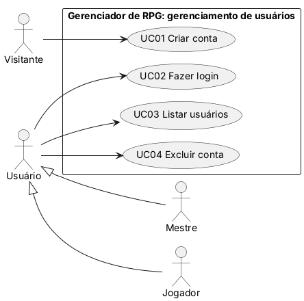
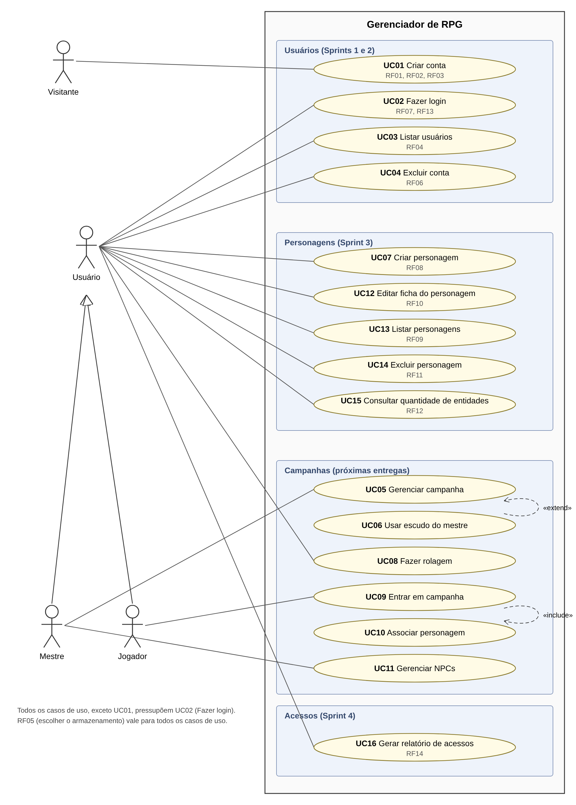

# Casos de uso

> Seção 6 do modelo. Os **requisitos** (RF) e seus **cenários de aceitação** estão em `openspec/specs/`.
> Aqui ficam o diagrama do gerenciamento de usuários, o diagrama completo do sistema e a descrição detalhada dos três casos de uso mais relevantes: UC01 (usuários) e UC07 e UC12 (personagem, a entidade da Sprint 3).

## 6.1 Diagrama de casos de uso: gerenciamento de usuários (S1.1)

Dois tipos de usuário, **Mestre** e **Jogador**, especializam o ator **Usuário** (generalização de atores). O **Visitante** ainda não tem conta. Fonte do diagrama em PlantUML: [`casos-de-uso.puml`](casos-de-uso.puml).

> As regras de login e senha (RF02, RF03) fazem parte do fluxo de UC01 e não são casos de uso separados, porque não são usadas por nenhum outro caso de uso nem entregam resultado próprio ao ator.
>
> O armazenamento (memória ou arquivo binário, RF05) é escolhido ao iniciar o sistema e vale para todos os casos de uso; por isso não aparece como caso de uso separado.

## 6.2 Diagrama de casos de uso completo

Todos os casos de uso do sistema, com os requisitos funcionais de cada um (RF01 a RF14). Os casos de uso de campanhas ainda não têm requisitos detalhados (ver visão §2.3 e o [cronograma](../00-entregas.md)). Fonte: [`img/casos-de-uso-completo.svg`](img/casos-de-uso-completo.svg). Versão original da Sprint 1: [`../diagramas/CasosDeUso-geral.pdf`](../diagramas/CasosDeUso-geral.pdf).

> Na Sprint 4 entrou o UC16 Gerar relatório de acessos (RF14). O UC02 Fazer login passou a registrar cada tentativa (RF13), que alimenta o relatório. Descrição em [UC16](UC16-gerar-relatorio-acessos.md).

> Na Sprint 3, o antigo "UC07 Gerenciar personagens" foi dividido em UC07 Criar personagem, UC12 Editar ficha, UC13 Listar personagens e UC14 Excluir personagem, um caso de uso por objetivo do ator. O ID UC07 foi mantido e os novos IDs continuam a numeração.

## Índice e rastreabilidade

| Caso de uso | Ator principal | Requisitos | Descrição detalhada |
|---|---|---|---|
| UC01 Criar conta | Visitante | RF01, RF02, RF03, RF05, NF-SEG-01, NF-USA-01, NF-CON-01, NF-MAN-01 | [UC01](UC01-criar-conta.md) |
| UC02 Fazer login | Usuário (Mestre, Jogador) | RF07, RF13, NF-SEG-02 | — |
| UC03 Listar usuários | Usuário | RF04, RF05, NF-SEG-01, NF-DES-01 | — |
| UC04 Excluir conta | Usuário | RF06, NF-CON-01, NF-CON-03 | — |
| UC05 Gerenciar campanha | Mestre | visão §2.3 (próximas entregas) | — |
| UC06 Usar escudo do mestre | Mestre | visão §2.3 | — |
| UC07 Criar personagem | Usuário | RF08, RF05, NF-USA-01, NF-CON-01 | [UC07](UC07-criar-personagem.md) |
| UC08 Fazer rolagem | Usuário | visão §2.3 | — |
| UC09 Entrar em campanha | Jogador | visão §2.3 | — |
| UC10 Associar personagem | Jogador | visão §2.3 | — |
| UC11 Gerenciar NPCs | Mestre | visão §2.3 | — |
| UC12 Editar ficha do personagem | Usuário | RF10, RF05, NF-USA-01, NF-CON-01 | [UC12](UC12-editar-ficha.md) |
| UC13 Listar personagens | Usuário | RF09 | — |
| UC14 Excluir personagem | Usuário | RF11, NF-CON-01 | — |
| UC15 Consultar quantidade de entidades | Usuário | RF12 | — |
| UC16 Gerar relatório de acessos | Usuário | RF14, RF13, RF05 | [UC16](UC16-gerar-relatorio-acessos.md) |

**Regra:** depois da primeira entrega, IDs de casos de uso **não** são renumerados nem reaproveitados.
