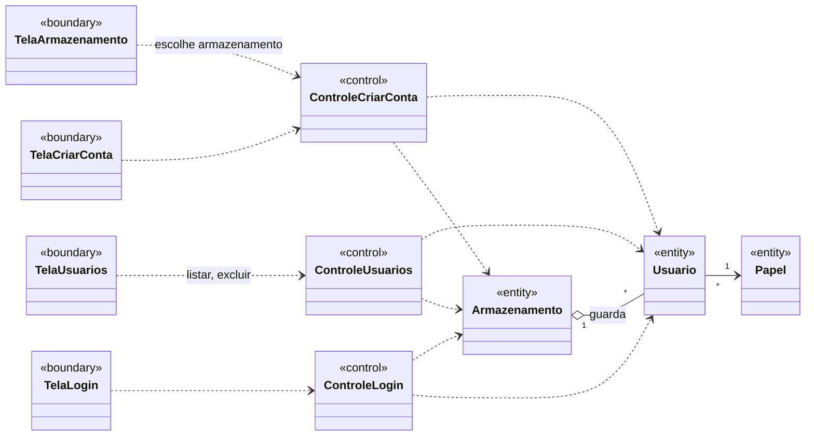
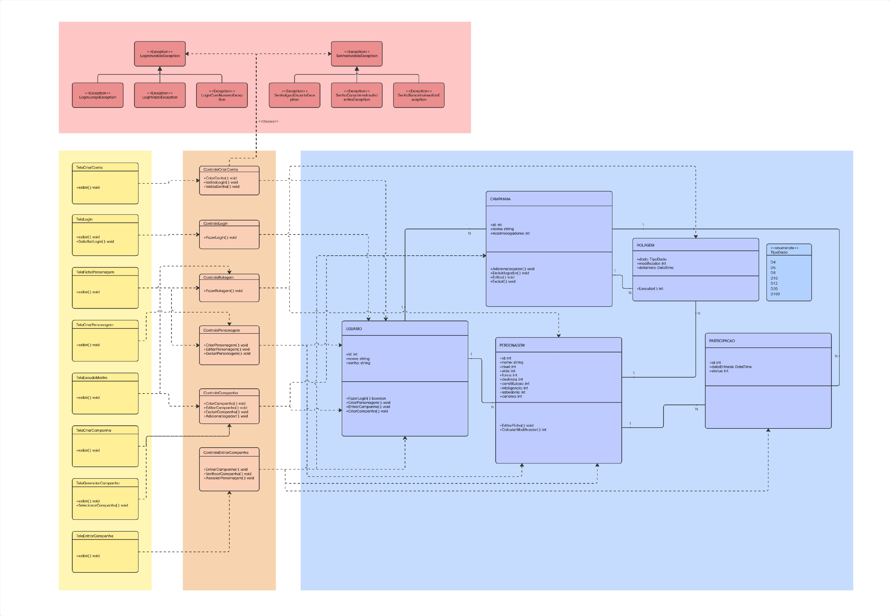
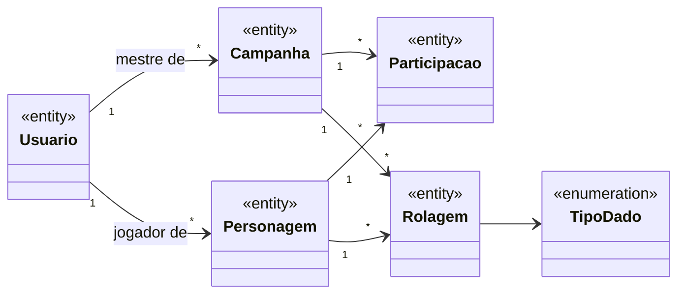

# Análise de casos de uso — diagrama de classes de análise

> Seção 7 do modelo. Classes **sem atributos e métodos**, mas com os relacionamentos já definidos.
> Estereótipos ICONIX: «boundary» (fronteira), «control» (controle), «entity» (entidade).
> Os nomes das entidades vêm do [glossário](02-glossario.md).

## 7.1 Gerenciamento de usuários (S1.2)

### Rastreabilidade caso de uso → classes de controle

| Caso de uso | Controle | Fronteiras |
|---|---|---|
| UC01 Criar conta | ControleCriarConta | TelaArmazenamento, TelaCriarConta |
| UC02 Fazer login | ControleLogin | TelaLogin |
| UC03 Listar usuários | ControleUsuarios | TelaUsuarios |
| UC04 Excluir conta | ControleUsuarios | TelaUsuarios |

> Na implementação de console (Sprints 1 e 2), as fronteiras TelaArmazenamento, TelaCriarConta e TelaUsuarios são realizadas pela classe `MenuPrincipal` (ver [08-projeto.md](08-projeto.md)). ControleLogin e TelaLogin entram com a autenticação (RF07).

## 7.2 Sistema completo

O diagrama de análise do sistema inteiro (campanhas, personagens, rolagens e participações) foi feito na Sprint 1 e está em [`diagramas/DiagramaClasses-analise.pdf`](diagramas/DiagramaClasses-analise.pdf):

Entidades principais e relacionamentos:

