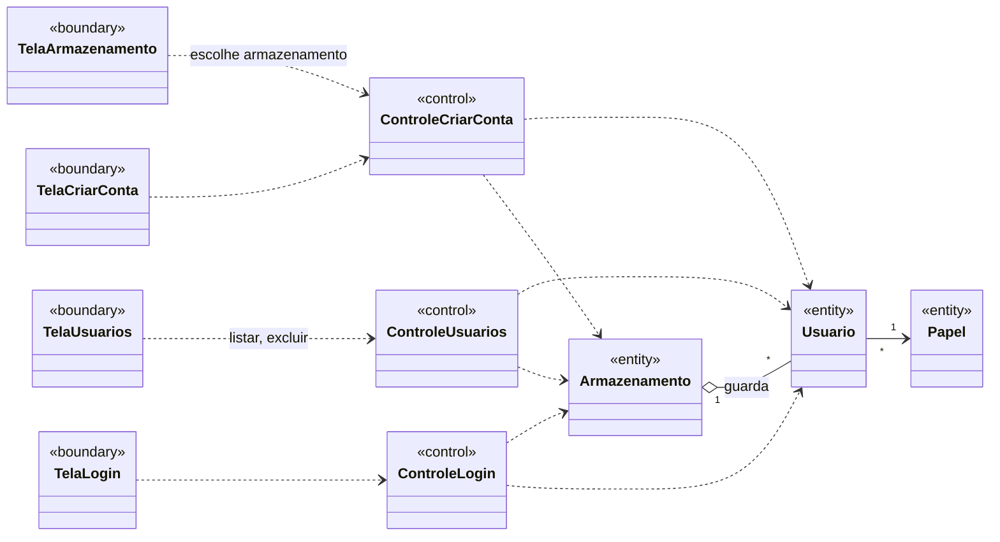
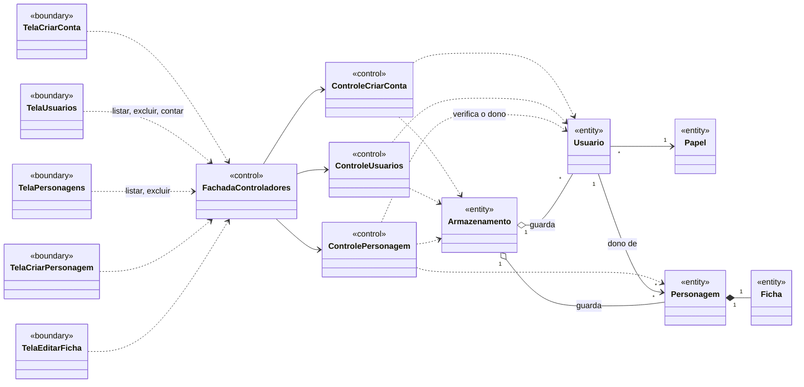
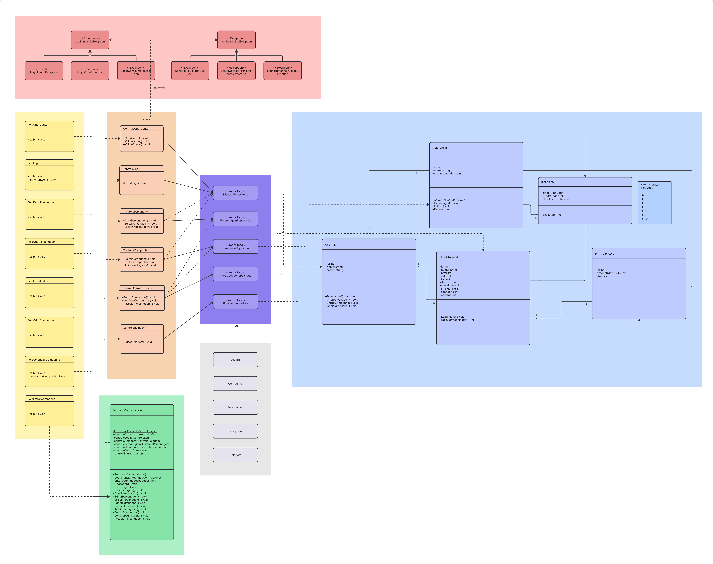
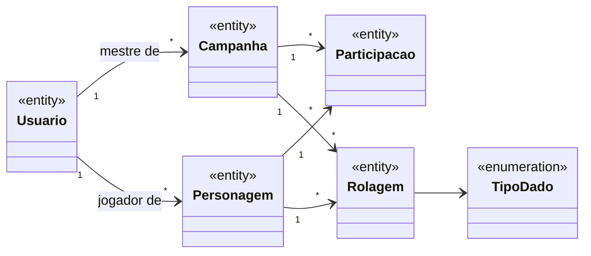

# Análise de casos de uso — diagrama de classes de análise

> Seção 7 do modelo. Classes **sem atributos e métodos**, mas com os relacionamentos já definidos.
> Estereótipos ICONIX: «boundary» (fronteira), «control» (controle), «entity» (entidade).
> Os nomes das entidades vêm do [glossário](02-glossario.md).

## 7.1 Gerenciamento de usuários (S1.2)

### Rastreabilidade caso de uso → classes de controle

| Caso de uso | Controle | Fronteiras |
|---|---|---|
| UC01 Criar conta | ControleCriarConta | TelaArmazenamento, TelaCriarConta |
| UC02 Fazer login | ControleLogin | TelaLogin |
| UC03 Listar usuários | ControleUsuarios | TelaUsuarios |
| UC04 Excluir conta | ControleUsuarios | TelaUsuarios |

> Na implementação de console (Sprints 1 e 2), as fronteiras TelaArmazenamento, TelaCriarConta e TelaUsuarios são realizadas pela classe `MenuPrincipal` (ver [08-projeto.md](08-projeto.md)). ControleLogin e TelaLogin entram com a autenticação (RF07).

## 7.2 Personagens e fachada única (Sprint 3)

CRUD de duas entidades, **Usuário** e **Personagem** (Usuário 1 → * Personagem), com uma fachada única que reúne os controles (Facade + Singleton). As fronteiras da interface conversam só com a fachada.

| Caso de uso | Controle | Fronteiras |
|---|---|---|
| UC07 Criar personagem | ControlePersonagem (via FachadaControladores) | TelaPersonagens, TelaCriarPersonagem |
| UC12 Editar ficha do personagem | ControlePersonagem | TelaPersonagens, TelaEditarFicha |
| UC13 Listar personagens | ControlePersonagem | TelaPersonagens |
| UC14 Excluir personagem | ControlePersonagem | TelaPersonagens |
| UC15 Consultar quantidade de entidades | FachadaControladores (soma usuários e personagens) | TelaUsuarios |

> `FachadaControladores` é o nome da classe no diagrama de análise do Gustavo (seção 7.3); no código ela se chama `FacadeSingletonController`, como pede o enunciado da Sprint 3 (ver [ADR-0004](07-arquitetura/adr/0004-fachada-singleton.md)). Na interface de console, TelaCriarConta e TelaUsuarios são realizadas por `MenuPrincipal`, e as telas de personagem por `MenuPersonagens`.

## 7.3 Sistema completo

O diagrama de análise do sistema inteiro (campanhas, personagens, rolagens e participações), atualizado na Sprint 3 com a `FachadaControladores` (Facade + Singleton) e o `ControlePersonagem`, está em [`diagramas/DiagramaClasses-analise.pdf`](diagramas/DiagramaClasses-analise.pdf):

Entidades principais e relacionamentos:

