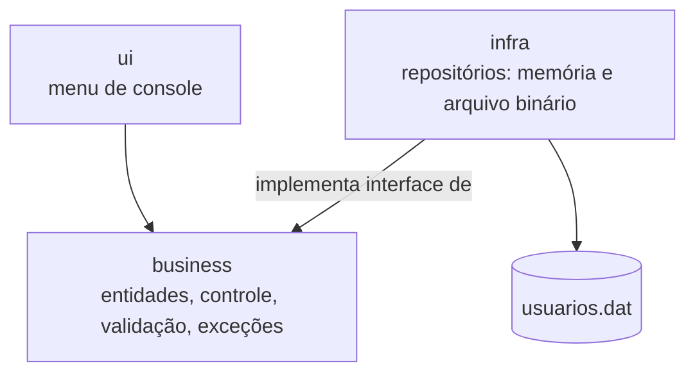

# Arquitetura

> Seção 9 do modelo. Os diagramas de arquitetura lógica e física (C4) e a tabela "como cada RNF é atendido" são itens da **Entrega 2** (ver [cronograma](../00-entregas.md)).
> Decisões importantes ficam registradas como ADRs em [`adr/`](adr/).

## Decisões registradas

| ADR | Decisão | Requisitos |
|---|---|---|
| [ADR-0001](adr/0001-persistencia-substituivel.md) | Tornar o mecanismo de armazenamento substituível | RF05, NF-MAN-01, NF-CON-01 |
| [ADR-0002](adr/0002-login-e-papel-no-usuario.md) | Renomear `nome` para `login` e acrescentar o papel ao usuário | RF01, RF02, RF04 |

## Visão atual (Entrega 1)

Aplicação de console monolítica em C++17, organizada em três camadas (ver [`../08-projeto.md`](../08-projeto.md)):

