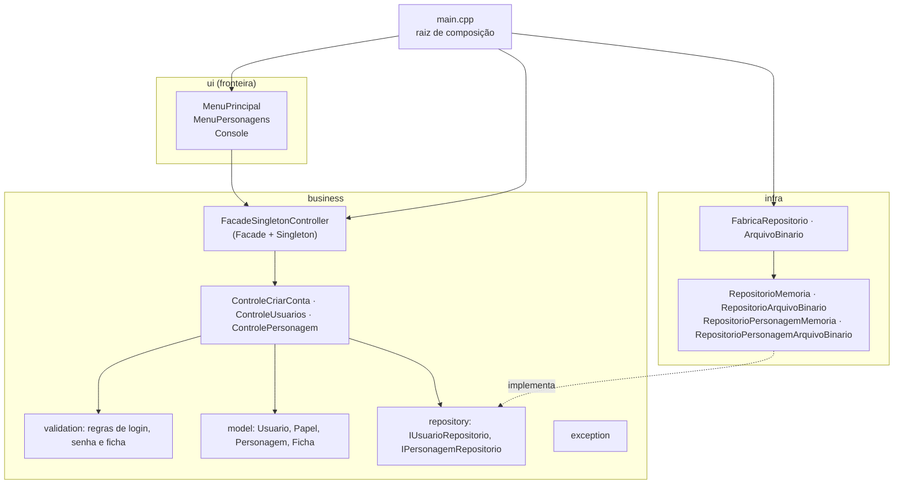
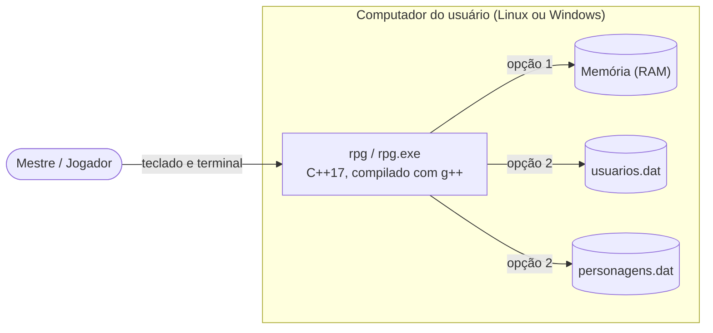

# Arquitetura

> Seção 9 do modelo. Arquitetura lógica e física do sistema até a Sprint 3 e como cada requisito não funcional é atendido.
> Decisões importantes ficam registradas como ADRs em [`adr/`](adr/).

## Decisões registradas

| ADR | Decisão | Requisitos |
|---|---|---|
| [ADR-0001](adr/0001-persistencia-substituivel.md) | Tornar o mecanismo de armazenamento substituível | RF05, NF-MAN-01, NF-CON-01 |
| [ADR-0002](adr/0002-login-e-papel-no-usuario.md) | Renomear `nome` para `login` e acrescentar o papel ao usuário | RF01, RF02, RF04 |
| [ADR-0003](adr/0003-id-automatico.md) | Gerar o ID do usuário no repositório | RF01, NF-CON-02 |
| [ADR-0004](adr/0004-fachada-singleton.md) | Fachada única com Singleton para os controles | RF08–RF12, NF-MAN-01 |

## Arquitetura lógica (Sprint 3)

Aplicação de console monolítica em C++17, em três camadas. A `ui` fala só com a fachada; a `business` define as interfaces dos repositórios; a `infra` as implementa. Só `main.cpp` (raiz de composição) conhece as três camadas.

## Arquitetura física

Um único executável, sem rede nem serviços externos (visão §2.3). Os dados ficam em memória ou em dois arquivos binários na pasta de onde o programa é executado.

## Como cada RNF é atendido

| RNF | Como é atendido | Onde |
|---|---|---|
| NF-SEG-01 Senha nunca exibida | A listagem não imprime a senha e as mensagens de erro de senha não a repetem | `MenuPrincipal::listarUsuarios`, `Excecoes.h`; teste `mensagens_de_erro_nao_devem_conter_a_senha` |
| NF-SEG-02 Falha de login sem pista | Planejado com RF07 (mensagem única "Login ou senha invalidos.") | — |
| NF-CON-01 Falha de armazenamento tratada | Toda falha de E/S vira `FalhaArmazenamentoException`, tratada no menu sem encerrar o programa; a alteração é desfeita na memória | `ArquivoBinario`, repositórios em arquivo, menus |
| NF-CON-02 Arquivo corrompido detectado | A carga confere tamanhos, IDs, papel e dados extras e lança `FalhaArmazenamentoException`; `main.cpp` passa a usar a memória | `ArquivoBinario::carregar`, `main.cpp` |
| NF-CON-03 Durabilidade dos cadastros | Cada alteração regrava o arquivo inteiro num `.tmp` que depois substitui o original | `ArquivoBinario::gravar` |
| NF-DES-01 Tempo de listagem e carga | Coleções em `std::map` carregadas uma vez ao iniciar; listagem sem acesso a disco | repositórios |
| NF-MAN-01 Armazenamento substituível | Controles dependem só das interfaces `IUsuarioRepositorio` e `IPersonagemRepositorio`; a `ui` depende só da fachada | ADR-0001, ADR-0004 |
| NF-MAN-02 Nova regra sem alterar as existentes | Strategy: `IRegraValidacao` (usuário) e `IRegraFicha` (personagem), uma classe por regra | `business/validation` |
| NF-MAN-03 Regras cobertas por testes | 44 testes automatizados (`make test`) | `test/` |
| NF-USA-01 Mensagem específica para cada recusa | Uma exceção por regra, com a mensagem da regra violada | `Excecoes.h` |
| NF-USA-02 Cadastro rápido de aprender | Menus numerados e pedidos campo a campo | `ui/` |
| NF-USA-03 Entrada inválida não encerra | Leitura linha a linha com conversão verificada (`console::lerInteiro`) | `ui/Console` |
| NF-POR-01 Linux e Windows sem dependências | Só a biblioteca padrão do C++17 e `make` | `src/Makefile` |
| NF-POR-02 Arquivo binário portável | Inteiros de tamanho fixo em little-endian, escritos byte a byte | `ArquivoBinario` |
