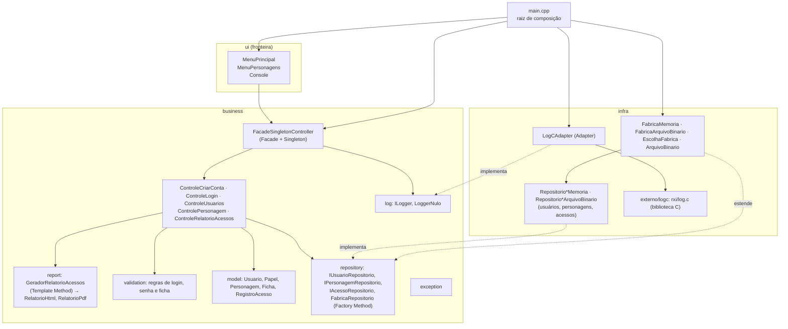
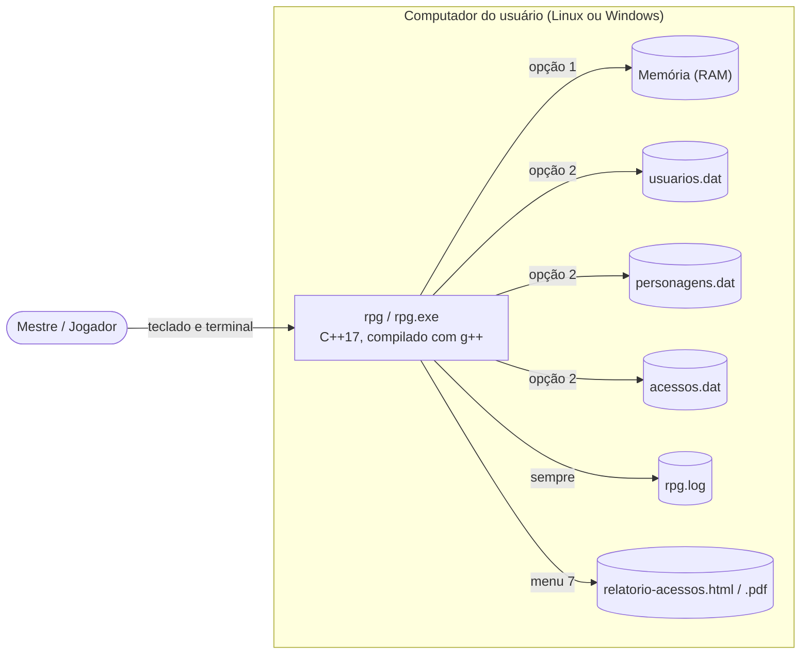

# Arquitetura

> Seção 9 do modelo. Arquitetura lógica e física do sistema até a Sprint 4 e como cada requisito não funcional é atendido.
> Decisões importantes ficam registradas como ADRs em [`adr/`](adr/).

## Decisões registradas

| ADR | Decisão | Requisitos |
|---|---|---|
| [ADR-0001](adr/0001-persistencia-substituivel.md) | Tornar o mecanismo de armazenamento substituível | RF05, NF-MAN-01, NF-CON-01 |
| [ADR-0002](adr/0002-login-e-papel-no-usuario.md) | Renomear `nome` para `login` e acrescentar o papel ao usuário | RF01, RF02, RF04 |
| [ADR-0003](adr/0003-id-automatico.md) | Gerar o ID do usuário no repositório | RF01, NF-CON-02 |
| [ADR-0004](adr/0004-fachada-singleton.md) | Fachada única com Singleton para os controles | RF08–RF12, NF-MAN-01 |
| [ADR-0005](adr/0005-repository-e-factory-method.md) | Repository por entidade e Factory Method para escolher o armazenamento | RF05, NF-MAN-01 |
| [ADR-0006](adr/0006-adapter-log.md) | Adapter para a biblioteca de log rxi/log.c | RF07, RF13, NF-SEG-01, NF-MAN-01 |
| [ADR-0007](adr/0007-relatorios-template-method.md) | Template Method para os relatórios de acesso em HTML e PDF | RF13, RF14, NF-MAN-01 |

## Arquitetura lógica (Sprint 4)

Aplicação de console monolítica em C++17, em três camadas. A `ui` fala só com a fachada. A `business` define as interfaces (repositórios, fábrica abstrata e `ILogger`), e a `infra` as implementa, inclusive o adaptador da biblioteca de log de terceiros. Só `main.cpp` (raiz de composição) conhece as três camadas.

## Arquitetura física

Um único executável, sem rede nem serviços externos (visão §2.3). Os dados ficam em memória ou em três arquivos binários na pasta de onde o programa é executado. Na mesma pasta ficam o log (`rpg.log`) e os relatórios gerados.

## Como cada RNF é atendido

| RNF | Como é atendido | Onde |
|---|---|---|
| NF-SEG-01 Senha nunca exibida | A listagem não imprime a senha, as mensagens de erro de senha não a repetem e o log nunca a registra | `MenuPrincipal::listarUsuarios`, `Excecoes.h`, `FacadeSingletonController`; testes `mensagens_de_erro_nao_devem_conter_a_senha` e `fachada_deve_registrar_login_aceito_e_recusado_sem_a_senha` |
| NF-SEG-02 Falha de login sem pista | Login inexistente e senha errada lançam a mesma `CredenciaisInvalidasException` ("Login ou senha invalidos.") | `ControleLogin`; testes `deve_recusar_senha_incorreta_sem_indicar_o_campo` e `deve_recusar_login_inexistente_com_a_mesma_mensagem` |
| NF-CON-01 Falha de armazenamento tratada | Toda falha de E/S vira `FalhaArmazenamentoException`, tratada no menu sem encerrar o programa; a alteração é desfeita na memória | `ArquivoBinario`, repositórios em arquivo, menus |
| NF-CON-02 Arquivo corrompido detectado | A carga confere tamanhos, IDs, papel e dados extras e lança `FalhaArmazenamentoException`; `main.cpp` passa a usar a memória | `ArquivoBinario::carregar`, `main.cpp` |
| NF-CON-03 Durabilidade dos cadastros | Cada alteração regrava o arquivo inteiro num `.tmp` que depois substitui o original | `ArquivoBinario::gravar` |
| NF-DES-01 Tempo de listagem e carga | Coleções em `std::map` carregadas uma vez ao iniciar; listagem sem acesso a disco | repositórios |
| NF-MAN-01 Armazenamento substituível | Controles dependem só das interfaces de repositório; os repositórios de um mecanismo são criados juntos por uma subclasse de `FabricaRepositorio`; a `ui` depende só da fachada | ADR-0001, ADR-0004, ADR-0005 |
| NF-MAN-02 Nova regra sem alterar as existentes | Strategy: `IRegraValidacao` (usuário) e `IRegraFicha` (personagem), uma classe por regra | `business/validation` |
| NF-MAN-03 Regras cobertas por testes | 73 testes automatizados (`make test`) | `test/` |
| NF-USA-01 Mensagem específica para cada recusa | Uma exceção por regra, com a mensagem da regra violada | `Excecoes.h` |
| NF-USA-02 Cadastro rápido de aprender | Menus numerados e pedidos campo a campo | `ui/` |
| NF-USA-03 Entrada inválida não encerra | Leitura linha a linha com conversão verificada (`console::lerInteiro`) | `ui/Console` |
| NF-POR-01 Linux e Windows sem dependências | Biblioteca padrão do C++17, `make` e a biblioteca de log rxi/log.c, copiada no repositório (C99, compilada com o `gcc` que acompanha o `g++` no MinGW); o PDF é escrito sem biblioteca | `src/Makefile`, `infra/externo/logc` |
| NF-POR-02 Arquivo binário portável | Inteiros de tamanho fixo em little-endian, escritos byte a byte | `ArquivoBinario` |
