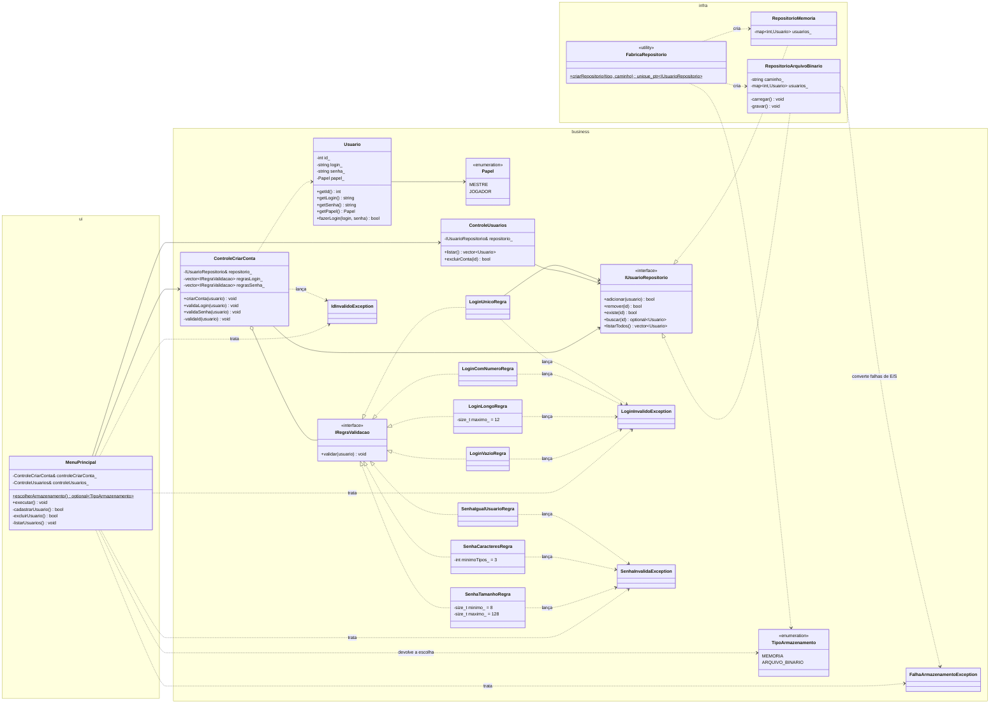
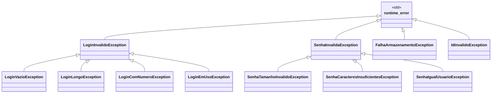

# Projeto detalhado — pacotes, classes de projeto e padrões

> O **diagrama de classes de projeto** evolui a cada sprint, diferente do diagrama de **análise** (`05-analise.md`), que é conceitual e muda pouco.
> Atualize este arquivo em **toda** sprint (ver [cronograma](00-entregas.md)).

## 1. Divisão de pacotes

```text
src/
├── main.cpp                  ← raiz de composição: cria o repositório escolhido (FabricaRepositorio), os controles e o menu
├── ui/                       ← fronteira: MenuPrincipal (console)
├── business/
│   ├── model/                ← entidades: Usuario, Papel
│   ├── control/              ← controles: ControleCriarConta (UC01), ControleUsuarios (UC03, UC04)
│   ├── validation/           ← IRegraValidacao e regras de login e de senha
│   ├── exception/            ← exceções de negócio: IdInvalidoException, LoginInvalidoException, SenhaInvalidaException, FalhaArmazenamentoException
│   └── repository/           ← interface IUsuarioRepositorio e enum TipoArmazenamento
└── infra/                    ← RepositorioMemoria, RepositorioArquivoBinario, FabricaRepositorio
test/                         ← um teste por cenário das regras (make test)
```

**Regra de dependência:** `ui` → `business` ← `infra`. A camada `business` não inclui nada de `ui` nem de `infra`; ela conhece só a interface `IUsuarioRepositorio`, e `infra` a implementa. Só o `main.cpp` (raiz de composição) conhece as três camadas e liga a escolha da `ui` à fábrica da `infra` (ver [ADR-0001](07-arquitetura/adr/0001-persistencia-substituivel.md)).

## 2. Diagrama de classes de projeto

### Estado atual: Sprints 1 e 2 (S2.1)

Validação dos campos com exceções e dois mecanismos de armazenamento (memória e arquivo binário).



Versão em imagem: [`diagramas/DiagramaClasses-projeto.png`](diagramas/DiagramaClasses-projeto.png).

### Hierarquia de exceções

Cada regra lança uma subclasse específica, e a interface trata pelas classes-base. Todas as exceções de negócio derivam de `std::runtime_error` (condição do ambiente ou dado do usuário, que pode ser contornada em tempo de execução), e não de `std::logic_error`, reservada a erros de programação. C++ não tem `IOException`: os erros de E/S do arquivo (`std::ios_base::failure`, arquivo truncado ou corrompido) são convertidos em `FalhaArmazenamentoException`.



| Exceção | Regra (requisito) | Mensagem |
|---|---|---|
| IdInvalidoException | RF01 | O ID deve ser um numero positivo. / Ja existe um usuario com esse ID. |
| LoginVazioException | RF02 | O login nao pode ser vazio. |
| LoginLongoException | RF02 | O login deve ter no maximo 12 caracteres. |
| LoginComNumeroException | RF02 | O login nao pode conter numeros. |
| LoginEmUsoException | RF01 | Login ja esta em uso. |
| SenhaTamanhoInvalidoException | RF03 | A senha deve ter entre 8 e 128 caracteres. |
| SenhaCaracteresInsuficientesException | RF03 | A senha deve conter ao menos 3 dos 4 tipos: maiusculas, minusculas, numeros e especiais. |
| SenhaIgualUsuarioException | RF03 | A senha nao pode ser igual ao login. |
| FalhaArmazenamentoException | NF-CON-01, NF-CON-02 | Descreve a falha do arquivo, sem dados do usuário |

### Formato do arquivo binário `usuarios.dat`

Inteiros de tamanho fixo, little-endian (NF-POR-02): `uint32` quantidade de usuários; para cada usuário, `int32` ID, `uint32` tamanho + bytes do login, `uint32` tamanho + bytes da senha, `uint8` papel (1 = Mestre, 2 = Jogador). A gravação é feita num arquivo temporário (`usuarios.dat.tmp`) que depois substitui o original; se falhar, a alteração é desfeita também em memória.

## 3. Princípios SOLID aplicados

| Princípio | Onde aparece |
|---|---|
| **S** Responsabilidade única | Um controle por caso de uso (`ControleCriarConta` para UC01, `ControleUsuarios` para UC03 e UC04); cada regra de validação é uma classe; a leitura e escrita do arquivo ficam só em `RepositorioArquivoBinario`; a entrada e saída de console ficam só em `MenuPrincipal` |
| **O** Aberto/fechado | Nova regra = nova classe que implementa `IRegraValidacao`; novo armazenamento = nova classe que implementa `IUsuarioRepositorio` (NF-MAN-01, NF-MAN-02) |
| **L** Substituição de Liskov | `RepositorioMemoria` e `RepositorioArquivoBinario` cumprem o mesmo contrato e passam nos mesmos testes de cadastro e listagem |
| **I** Segregação de interfaces | `IRegraValidacao` tem um único método; `IUsuarioRepositorio` só tem as operações usadas pelo controle |
| **D** Inversão de dependência | Os controles dependem de `IUsuarioRepositorio`, recebido no construtor; só `main.cpp` conhece as classes concretas de `infra` |

## 4. Padrões de projeto utilizados

| Padrão | Sprint | Classes participantes (papel no padrão) | Problema que resolve no projeto | ADR |
|---|---|---|---|---|
| Strategy (regras de validação) | S2 | IRegraValidacao (estratégia), regras de login e senha (estratégias concretas), ControleCriarConta (contexto) | Acrescentar regras sem alterar as existentes (NF-MAN-02) | — |
| Injeção de dependência | S2 | ControleCriarConta recebe IUsuarioRepositorio no construtor | Trocar o armazenamento sem alterar o controle (NF-MAN-01) | [ADR-0001](07-arquitetura/adr/0001-persistencia-substituivel.md) |
| Singleton | S3 | | | |
| Facade | S3 | | | |
| Repository | S4 | (iniciado na S2: IUsuarioRepositorio, RepositorioMemoria, RepositorioArquivoBinario) | | |
| Factory Method / Abstract Factory | S4 | (iniciado na S2: FabricaRepositorio) | | |
| Adapter | S4 | | | |
| Template Method | S4 | | | |
| Command | S5 | | | |
| Memento | S5 | | | |

## 5. Rastreabilidade requisito → código → teste

Testes em `test/testes.cpp` (`cd src && make test`).

| Requisito | Classes | Testes | Situação |
|---|---|---|---|
| RF01 Cadastrar usuário | ControleCriarConta, LoginUnicoRegra, IdInvalidoException | deve_recusar_login_ja_existente, deve_recusar_cadastro_com_id_duplicado, deve_recusar_id_nao_positivo | Implementado |
| RF02 Regras de login | LoginVazioRegra, LoginLongoRegra, LoginComNumeroRegra | deve_recusar_login_vazio, deve_recusar_login_so_com_espacos, deve_recusar_login_com_13_caracteres, deve_aceitar_login_com_12_caracteres, deve_recusar_login_com_numeros | Implementado |
| RF03 Regras de senha | SenhaTamanhoRegra, SenhaCaracteresRegra, SenhaIgualUsuarioRegra | deve_recusar_senha_com_menos_de_8_caracteres, deve_recusar_senha_com_mais_de_128_caracteres, deve_recusar_senha_com_apenas_2_tipos_de_caractere, deve_aceitar_senha_com_3_tipos_de_caractere, deve_recusar_senha_igual_ao_login | Implementado |
| RF04 Listar usuários | ControleUsuarios, MenuPrincipal | listar_deve_retornar_os_usuarios_cadastrados, listar_sem_usuarios_deve_retornar_vazio | Implementado |
| RF05 Escolher o armazenamento | MenuPrincipal, FabricaRepositorio, RepositorioMemoria, RepositorioArquivoBinario | repositorio_memoria_deve_comecar_vazio, repositorio_binario_deve_persistir_entre_instancias | Implementado |
| RF06 Excluir usuário | ControleUsuarios | deve_excluir_usuario_existente, excluir_id_inexistente_deve_retornar_falso | Implementado |
| RF07 Autenticar | Usuario::fazerLogin | — | Planejado (Entrega 2) |
| NF-SEG-01 Senha nunca exibida | MenuPrincipal, Excecoes.h | mensagens_de_erro_nao_devem_conter_a_senha | Implementado |
| NF-SEG-02 Falha de login sem pista | — | — | Planejado com RF07 |
| NF-MAN-01, NF-MAN-02 | IUsuarioRepositorio, IRegraValidacao | — (verificado por revisão do projeto) | Implementado |
| NF-MAN-03 Testes automatizados | test/ | 22 testes | Implementado |
| NF-CON-01, NF-CON-02, NF-CON-03 | RepositorioArquivoBinario, FalhaArmazenamentoException | arquivo_binario_truncado_deve_lancar_falha_armazenamento, arquivo_binario_corrompido_deve_lancar_falha_armazenamento | Implementado |
| NF-DES-01 Tempo de listagem e carga | RepositorioArquivoBinario | medição manual em 14/10/2026: carga de 10.000 usuários em ~11 ms e listagem em ~5 ms | Atendido |
| NF-USA-01, NF-USA-03 | MenuPrincipal, Excecoes.h | — (verificado executando o programa) | Implementado |
| NF-USA-02 Cadastro rápido de aprender | — | teste com usuários planejado | A medir |
| NF-POR-01, NF-POR-02 | Makefile, RepositorioArquivoBinario | compilado em Linux (g++, 0 avisos); Windows a verificar pela equipe | Parcial |
