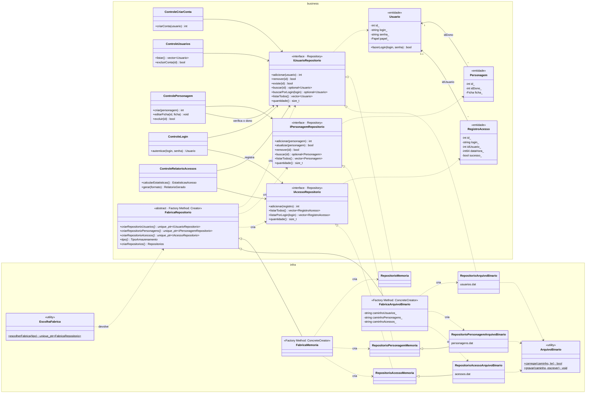
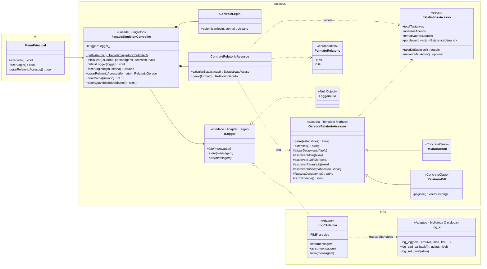
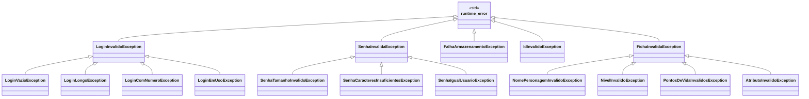

# Projeto detalhado — pacotes, classes de projeto e padrões

> O **diagrama de classes de projeto** evolui a cada sprint, diferente do diagrama de **análise** (`05-analise.md`), que é conceitual e muda pouco.
> Atualize este arquivo em **toda** sprint (ver [cronograma](00-entregas.md)).

## 1. Divisão de pacotes

```text
src/
├── main.cpp                  ← raiz de composição: cria o LogCAdapter e os repositórios escolhidos (`escolherFabrica(tipo)->criarRepositorios()`), inicializa a fachada e abre o menu
├── ui/                       ← fronteira: MenuPrincipal, MenuPersonagens, Console (leitura do teclado)
├── business/
│   ├── model/                ← entidades: Usuario, Papel, Personagem, Ficha (com Atributos), RegistroAcesso
│   ├── control/              ← FacadeSingletonController (fachada única) e os controles ControleCriarConta (UC01), ControleLogin (UC02), ControleUsuarios (UC03, UC04), ControlePersonagem (UC07, UC12–UC14), ControleRelatorioAcessos (UC16)
│   ├── validation/           ← IRegraValidacao (login e senha) e IRegraFicha (ficha do personagem)
│   ├── exception/            ← exceções de negócio: Login/Senha/FichaInvalida, CredenciaisInvalidas, IdInvalidoException, FalhaArmazenamentoException
│   ├── repository/           ← interfaces IUsuarioRepositorio, IPersonagemRepositorio e IAcessoRepositorio (Repository), FabricaRepositorio (Creator do Factory Method), enum TipoArmazenamento
│   ├── report/               ← Template Method: GeradorRelatorioAcessos, RelatorioHtml, RelatorioPdf, EstatisticasAcesso, FormatoRelatorio
│   └── log/                  ← ILogger (Target do Adapter) e LoggerNulo
└── infra/                    ← repositórios em memória e em arquivo binário, ArquivoBinario, fábricas concretas (FabricaMemoria, FabricaArquivoBinario), EscolhaFabrica e LogCAdapter
    └── externo/logc/         ← biblioteca de terceiros rxi/log.c (Adaptee), sem alterações
test/                         ← um teste por cenário das regras (make test)
```

**Regra de dependência:** `ui` → `business` ← `infra`. A `ui` só conhece a `FacadeSingletonController` (ver [ADR-0004](07-arquitetura/adr/0004-fachada-singleton.md)). A camada `business` não inclui nada de `ui` nem de `infra`; ela conhece só as interfaces (`I...Repositorio`, `FabricaRepositorio`, `ILogger`), e `infra` as implementa. Só o `main.cpp` (raiz de composição) conhece as três camadas e liga a escolha da `ui` à fábrica da `infra` (`escolherFabrica`) (ver [ADR-0001](07-arquitetura/adr/0001-persistencia-substituivel.md)).

## 2. Diagrama de classes de projeto

### Estado atual: Sprint 4 (S4.1)

A Sprint 4 separa por completo a comunicação entre a camada **business** e a de persistência (**infra**) para as três entidades persistidas (Usuário, Personagem e o novo **RegistroAcesso**), e acrescenta o Adapter e o Template Method. O diagrama foi dividido em dois para continuar legível. Os estereótipos indicam o papel de cada classe no padrão. O diagrama de **análise** com a caixa de repositórios, desenhado pelo Gustavo, está em `05-analise.md` §7.3.

#### a) Separação business × infra: Repository e Factory Method

A business define as entidades, as interfaces de repositório (só com tipos do domínio) e o *Creator* abstrato `FabricaRepositorio`. A infra implementa tudo isso: um repositório em memória e um em arquivo binário por entidade, e um *Creator* concreto por mecanismo. Nenhuma seta sai da business para a infra. Versão em imagem: [`diagramas/DiagramaClasses-projeto-S4-business-infra.png`](diagramas/DiagramaClasses-projeto-S4-business-infra.png). Decisão em [ADR-0005](07-arquitetura/adr/0005-repository-e-factory-method.md).



#### b) Fachada, Template Method e Adapter

A `ui` continua falando só com a fachada. Os relatórios de acesso usam Template Method na business ([ADR-0007](07-arquitetura/adr/0007-relatorios-template-method.md)). O log usa o Adapter: a business conhece só `ILogger`, e a biblioteca C fica atrás do `LogCAdapter` na infra ([ADR-0006](07-arquitetura/adr/0006-adapter-log.md)). Versão em imagem: [`diagramas/DiagramaClasses-projeto-S4-padroes.png`](diagramas/DiagramaClasses-projeto-S4-padroes.png).



### Sprint 3 (S3.1)

Nova entidade **Personagem** (Usuário 1 → * Personagem) com CRUD completo e a fachada única **FacadeSingletonController** (Facade + Singleton) para os controles, com `obterQuantidadeEntidades()`. Os IDs de usuário e de personagem são gerados pelos repositórios ([ADR-0003](07-arquitetura/adr/0003-id-automatico.md)). Para não repetir o diagrama da Sprint 2, as regras de login e senha aparecem só pela interface `IRegraValidacao`.


> Na S4 a fábrica ganhou `criarRepositorioAcessos()` e as funções livres antigas da `infra` foram removidas (ver diagrama da S4.1).

### Sprints 1 e 2 (S2.1)

Validação dos campos com exceções e dois mecanismos de armazenamento (memória e arquivo binário).


Versão em imagem: [`diagramas/DiagramaClasses-projeto.png`](diagramas/DiagramaClasses-projeto.png).

### Hierarquia de exceções

Cada regra lança uma subclasse específica, e a interface trata pelas classes-base. Todas as exceções de negócio derivam de `std::runtime_error` (condição do ambiente ou dado do usuário, que pode ser contornada em tempo de execução), e não de `std::logic_error`, reservada a erros de programação. C++ não tem `IOException`: os erros de E/S do arquivo (`std::ios_base::failure`, arquivo truncado ou corrompido) são convertidos em `FalhaArmazenamentoException`.



| Exceção | Regra (requisito) | Mensagem |
|---|---|---|
| LoginVazioException | RF02 | O login nao pode ser vazio. |
| LoginLongoException | RF02 | O login deve ter no maximo 12 caracteres. |
| LoginComNumeroException | RF02 | O login nao pode conter numeros. |
| LoginEmUsoException | RF01 | Login ja esta em uso. |
| SenhaTamanhoInvalidoException | RF03 | A senha deve ter entre 8 e 128 caracteres. |
| SenhaCaracteresInsuficientesException | RF03 | A senha deve conter ao menos 3 dos 4 tipos: maiusculas, minusculas, numeros e especiais. |
| SenhaIgualUsuarioException | RF03 | A senha nao pode ser igual ao login. |
| IdInvalidoException | RF08, RF10 | Nao existe usuario com esse ID para ser o dono. / Nao existe personagem com esse ID. |
| NomePersonagemInvalidoException | RF08, RF10 | O nome do personagem deve ter de 1 a 30 caracteres. |
| NivelInvalidoException | RF08, RF10 | O nivel deve estar entre 1 e 20. |
| PontosDeVidaInvalidosException | RF08, RF10 | Os pontos de vida devem ser maiores que zero. |
| AtributoInvalidoException | RF08, RF10 | O atributo &lt;nome&gt; deve estar entre 1 e 30. |
| FalhaArmazenamentoException | NF-CON-01, NF-CON-02 | Descreve a falha do arquivo, sem dados do usuário |

### Formato dos arquivos binários

Inteiros de tamanho fixo, little-endian (NF-POR-02): `int32` próximo ID a ser atribuído (ADR-0003), `uint32` quantidade de usuários; para cada usuário, `int32` ID, `uint32` tamanho + bytes do login, `uint32` tamanho + bytes da senha, `uint8` papel (1 = Mestre, 2 = Jogador). 

`personagens.dat`: `int32` próximo ID, `uint32` quantidade; para cada personagem, `int32` ID, `int32` ID do dono, `uint32` tamanho + bytes do nome, e oito `int32`: nível, pontos de vida, Força, Destreza, Constituição, Inteligência, Sabedoria e Carisma.

`acessos.dat` (S4): `int32` próximo ID, `uint32` quantidade; para cada registro, `int32` ID, `uint32` tamanho + bytes do login, `int32` ID do usuário (0 se o login não existe), `int64` data e hora em segundos desde 1970 (UTC) e `uint8` resultado (1 = aceito, 0 = recusado).

Nos três arquivos, a gravação é feita num arquivo temporário (`.tmp`) que depois substitui o original; se falhar, a alteração é desfeita também em memória. A leitura e a gravação ficam no módulo `infra/ArquivoBinario`, usado pelos três repositórios em arquivo.

## 3. Princípios SOLID aplicados

| Princípio | Onde aparece |
|---|---|
| **S** Responsabilidade única | Um controle por grupo de casos de uso (`ControleCriarConta` UC01, `ControleUsuarios` UC03/UC04, `ControlePersonagem` UC07/UC12–UC14); a fachada só repassa e coordena; cada regra de validação é uma classe; a E/S binária fica em `ArquivoBinario`; a leitura do teclado fica em `ui/Console`; calcular estatísticas (`ControleRelatorioAcessos`) é separado de formatar o relatório (`GeradorRelatorioAcessos`) |
| **O** Aberto/fechado | Nova regra = nova classe que implementa `IRegraValidacao` ou `IRegraFicha`; novo armazenamento = nova subclasse de `FabricaRepositorio`; novo formato de relatório = nova subclasse de `GeradorRelatorioAcessos`; nova biblioteca de log = novo adaptador de `ILogger` (NF-MAN-01, NF-MAN-02) |
| **L** Substituição de Liskov | Os repositórios em memória e em arquivo cumprem o mesmo contrato; `RepositorioPersonagemArquivoBinario` estende a versão em memória sem mudar o comportamento esperado, só acrescentando a gravação |
| **I** Segregação de interfaces | `IRegraValidacao` e `IRegraFicha` têm um único método; a regra de ficha não depende de `Usuario`; um repositório por entidade, e `IAcessoRepositorio` só tem as operações que o histórico precisa (sem alterar nem remover) |
| **D** Inversão de dependência | Os controles dependem das interfaces de repositório, recebidas no construtor; a `ui` depende da fachada recebida no construtor; a fachada depende de `ILogger`, não da biblioteca de log; só `main.cpp` conhece as classes concretas de `infra` |

## 4. Padrões de projeto utilizados

| Padrão | Sprint | Classes participantes (papel no padrão) | Problema que resolve no projeto | ADR |
|---|---|---|---|---|
| Strategy (regras de validação) | S2, S3 | IRegraValidacao e IRegraFicha (estratégias), regras de login, senha e ficha (estratégias concretas), ControleCriarConta e ControlePersonagem (contextos) | Acrescentar regras sem alterar as existentes (NF-MAN-02) | — |
| Injeção de dependência | S2 | ControleCriarConta recebe IUsuarioRepositorio no construtor | Trocar o armazenamento sem alterar o controle (NF-MAN-01) | [ADR-0001](07-arquitetura/adr/0001-persistencia-substituivel.md) |
| Singleton | S3 | FacadeSingletonController (construtor privado, `getInstancia()` com `static` local, cópia proibida) | Uma única fachada para toda a aplicação, inicializada uma vez em `main.cpp` | [ADR-0004](07-arquitetura/adr/0004-fachada-singleton.md) |
| Facade | S3 | FacadeSingletonController (fachada); ControleCriarConta, ControleUsuarios, ControlePersonagem (subsistema); MenuPrincipal, MenuPersonagens (clientes) | A `ui` usa um único ponto de entrada; operações entre entidades (exclusão em cascata, contagem de entidades) ficam no negócio | [ADR-0004](07-arquitetura/adr/0004-fachada-singleton.md) |
| Repository | S4 | Interfaces IUsuarioRepositorio, IPersonagemRepositorio e IAcessoRepositorio na business (só tipos do domínio); implementações em memória e em arquivo binário na infra | A business trata os dados como uma coleção em memória, sem saber onde ficam; regras de negócio ficam nos controles; os testes usam a versão em memória | [ADR-0005](07-arquitetura/adr/0005-repository-e-factory-method.md) |
| Factory Method | S4 | FabricaRepositorio (Creator abstrato, na business; declara os factory methods `criarRepositorioUsuarios()`, `criarRepositorioPersonagens()` e `criarRepositorioAcessos()`), FabricaMemoria e FabricaArquivoBinario (Creators concretos, na infra, decidem a classe instanciada), IUsuarioRepositorio, IPersonagemRepositorio e IAcessoRepositorio (produtos), `escolherFabrica()` (seleciona o Creator a partir de TipoArmazenamento) | Escolher o tipo de repositório (RF05) sem `if` espalhado e sem que a business conheça classes da infra; novo mecanismo = nova subclasse (NF-MAN-01) | [ADR-0005](07-arquitetura/adr/0005-repository-e-factory-method.md) |
| Adapter | S4 | ILogger (Target, na business), LogCAdapter (Adapter, na infra), biblioteca rxi/log.c em `infra/externo/logc` (Adaptee); LoggerNulo (Null Object) quando não há log | Registrar eventos em `rpg.log` com uma biblioteca C pronta sem que a business dependa dela; trocar de biblioteca = novo adaptador | [ADR-0006](07-arquitetura/adr/0006-adapter-log.md) |
| Template Method | S4 | GeradorRelatorioAcessos (classe abstrata; `gerar()` é o método-template, não virtual), RelatorioHtml e RelatorioPdf (subclasses concretas), `textoRodape()` (gancho) | Gerar o relatório de acessos em HTML e PDF com as mesmas seções, na mesma ordem; formato novo = nova subclasse | [ADR-0007](07-arquitetura/adr/0007-relatorios-template-method.md) |
| Null Object | S4 | LoggerNulo (implementa ILogger sem fazer nada) | A fachada funciona sem logger definido (testes) sem espalhar `if (logger != nullptr)` | [ADR-0006](07-arquitetura/adr/0006-adapter-log.md) |
| Command | S5 | | | |
| Memento | S5 | | | |

## 5. Rastreabilidade requisito → código → teste

Testes em `test/testes.cpp`, `test/testes_personagem.cpp`, `test/testes_fachada.cpp`, `test/testes_fabrica.cpp`, `test/testes_acesso.cpp`, `test/testes_login.cpp`, `test/testes_log.cpp` e `test/testes_relatorio.cpp` (`cd src && make test`).

| Requisito | Classes | Testes | Situação |
|---|---|---|---|
| RF01 Cadastrar usuário | ControleCriarConta, LoginUnicoRegra, IUsuarioRepositorio (ID automático) | deve_recusar_login_ja_existente, deve_gerar_ids_sequenciais_a_partir_de_1, deve_ignorar_id_informado_no_cadastro, nao_deve_reaproveitar_id_de_usuario_excluido, repositorio_binario_deve_persistir_entre_instancias | Implementado |
| RF02 Regras de login | LoginVazioRegra, LoginLongoRegra, LoginComNumeroRegra | deve_recusar_login_vazio, deve_recusar_login_so_com_espacos, deve_recusar_login_com_13_caracteres, deve_aceitar_login_com_12_caracteres, deve_recusar_login_com_numeros | Implementado |
| RF03 Regras de senha | SenhaTamanhoRegra, SenhaCaracteresRegra, SenhaIgualUsuarioRegra | deve_recusar_senha_com_menos_de_8_caracteres, deve_recusar_senha_com_mais_de_128_caracteres, deve_recusar_senha_com_apenas_2_tipos_de_caractere, deve_aceitar_senha_com_3_tipos_de_caractere, deve_recusar_senha_igual_ao_login | Implementado |
| RF04 Listar usuários | ControleUsuarios, MenuPrincipal | listar_deve_retornar_os_usuarios_cadastrados, listar_sem_usuarios_deve_retornar_vazio | Implementado |
| RF05 Escolher o armazenamento | MenuPrincipal, FabricaRepositorio, FabricaMemoria, FabricaArquivoBinario, EscolhaFabrica, repositórios em memória e em arquivo | escolher_fabrica_deve_devolver_a_fabrica_do_tipo_pedido, fabrica_memoria_deve_criar_repositorios_vazios, fabrica_memoria_deve_criar_repositorios_independentes, fabrica_arquivo_deve_criar_repositorios_que_persistem, fabrica_arquivo_deve_lancar_falha_com_arquivo_corrompido, repositorio_memoria_deve_comecar_vazio, repositorio_binario_deve_persistir_entre_instancias, repositorio_personagem_binario_deve_persistir_entre_instancias, repositorio_acesso_binario_deve_persistir_entre_instancias | Implementado |
| RF06 Excluir usuário | ControleUsuarios, FacadeSingletonController | deve_excluir_usuario_existente, excluir_id_inexistente_deve_retornar_falso, excluir_usuario_deve_excluir_os_personagens_dele | Implementado |
| RF08 Criar personagem | ControlePersonagem, regras de ficha, IPersonagemRepositorio | deve_criar_personagem_com_id_automatico, deve_recusar_personagem_de_usuario_inexistente, deve_recusar_personagem_com_ficha_invalida, deve_recusar_nome_de_personagem_vazio, deve_recusar_nome_de_personagem_com_31_caracteres, deve_recusar_nivel_fora_de_1_a_20, deve_recusar_pontos_de_vida_zerados, deve_recusar_atributo_fora_de_1_a_30 | Implementado |
| RF09 Listar personagens | ControlePersonagem, MenuPersonagens, calcularModificador | modificador_deve_arredondar_para_baixo, repositorio_personagem_memoria_deve_fazer_crud | Implementado |
| RF10 Editar ficha | ControlePersonagem, Personagem::comFicha | deve_editar_ficha_mantendo_o_dono, deve_recusar_edicao_com_ficha_invalida_sem_alterar, editar_personagem_inexistente_deve_lancar_id_invalido, editar_ficha_deve_manter_id_e_dono | Implementado |
| RF11 Excluir personagem | ControlePersonagem | deve_excluir_personagem | Implementado |
| RF12 Quantidade de entidades | FacadeSingletonController::obterQuantidadeEntidades | fachada_deve_contar_entidades_cadastradas, fachada_deve_ser_instancia_unica | Implementado |
| RF07 Autenticar | ControleLogin, IUsuarioRepositorio::buscarPorLogin, Usuario::fazerLogin, MenuPrincipal | deve_autenticar_com_login_e_senha_corretos, deve_recusar_senha_incorreta_sem_indicar_o_campo, deve_recusar_login_inexistente_com_a_mesma_mensagem | Parcial: autentica e informa o papel; menus por papel ficam para quando houver funções exclusivas |
| RF13 Registrar acessos | RegistroAcesso, ControleLogin, IAcessoRepositorio e repositórios de acesso | login_aceito_deve_ser_registrado_como_sucesso, login_recusado_deve_ser_registrado_como_falha, fachada_deve_fazer_login_e_registrar_o_acesso, repositorio_acesso_memoria_deve_atribuir_ids_em_sequencia, repositorio_acesso_deve_listar_por_login, repositorio_acesso_binario_deve_persistir_entre_instancias, arquivo_de_acessos_corrompido_deve_lancar_falha_armazenamento | Implementado |
| RF14 Relatório de acessos | ControleRelatorioAcessos, EstatisticasAcesso, GeradorRelatorioAcessos, RelatorioHtml, RelatorioPdf, MenuPrincipal | estatisticas_devem_contar_tentativas_aceitas_e_recusadas, estatisticas_devem_listar_todos_os_usuarios_com_seus_acessos, estatisticas_sem_acessos_devem_ficar_zeradas, template_method_deve_chamar_os_passos_sempre_na_mesma_ordem, relatorio_html_deve_conter_resumo_e_tabela_por_usuario, relatorio_html_deve_escapar_caracteres_especiais, relatorio_pdf_deve_ser_um_pdf_valido_com_os_dados, relatorio_pdf_com_muitos_usuarios_deve_quebrar_em_paginas, fachada_deve_gerar_relatorio_no_formato_pedido | Implementado |
| NF-SEG-01 Senha nunca exibida | MenuPrincipal, Excecoes.h, FacadeSingletonController (log) | mensagens_de_erro_nao_devem_conter_a_senha, fachada_deve_registrar_login_aceito_e_recusado_sem_a_senha | Implementado |
| NF-SEG-02 Falha de login sem pista | CredenciaisInvalidasException, ControleLogin | deve_recusar_senha_incorreta_sem_indicar_o_campo, deve_recusar_login_inexistente_com_a_mesma_mensagem | Implementado |
| NF-MAN-01, NF-MAN-02 | IUsuarioRepositorio, IRegraValidacao | — (verificado por revisão do projeto) | Implementado |
| NF-MAN-03 Testes automatizados | test/ | 73 testes | Implementado |
| NF-CON-01, NF-CON-02, NF-CON-03 | ArquivoBinario, repositórios em arquivo, FalhaArmazenamentoException | arquivo_binario_truncado_deve_lancar_falha_armazenamento, arquivo_binario_corrompido_deve_lancar_falha_armazenamento, arquivo_de_personagens_corrompido_deve_lancar_falha_armazenamento | Implementado |
| NF-DES-01 Tempo de listagem e carga | RepositorioArquivoBinario | medição manual em 14/10/2026: carga de 10.000 usuários em ~11 ms e listagem em ~5 ms | Atendido |
| NF-USA-01, NF-USA-03 | MenuPrincipal, Excecoes.h | — (verificado executando o programa) | Implementado |
| NF-USA-02 Cadastro rápido de aprender | — | teste com usuários planejado | A medir |
| NF-POR-01, NF-POR-02 | Makefile, RepositorioArquivoBinario | compilado em Linux (g++, 0 avisos); Windows a verificar pela equipe | Parcial |
